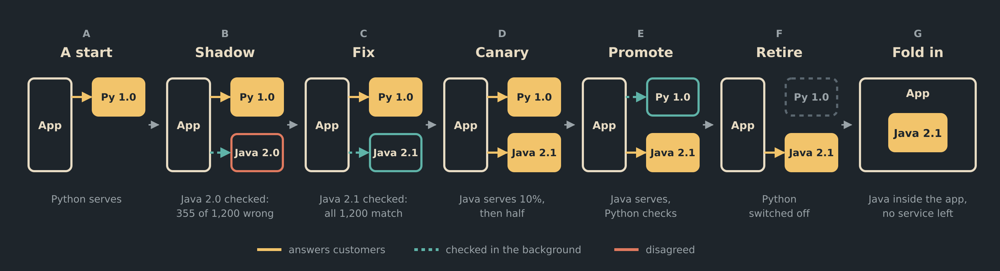

# The Governor: Letting Evidence Reshape a System

*Nobody ever finishes a system. Progressive delivery, remote-first contracts and a feedback loop that lets a system change its own shape.*

*Part 1 of Realising the System, giving shape to amorphic systems, one working piece at a time. The ideas come from the [Amorphic Systems series](https://medium.com/@stephen.james.price/amorphic-systems-a-map-of-the-series-and-why-its-one-idea-not-fourteen-5aad6932a998).*

**TL;DR**

- Systems are never finished, so their shape should be able to change after design time, not only their parts.
- Progressive delivery already gates new versions on evidence. A governor can use the same evidence to decide where a module runs: folded into its caller, or split out as a service.
- A small demo shows that loop running: a governor proposes each step from the evidence, and a human approves it.
- *4th bullet to show there is a human at the keyboard ;-)*

Nobody ever finishes a system. Even a system that nobody wants to change will be forced to. A dependency publishes a vulnerability, and code that has been stable for years must be rebuilt and redeployed within days. Log4Shell made that point to most of the industry back in 2021.

Yet we still design systems as if they were finished. We pick a shape at design time, build it, and treat every later change of shape as a project. I think it is time to rethink how we do things. Here are my thoughts.

## Shapes

At design time we usually pick a single shape, such as an application calling a service, and it stays fixed until someone replaces it: **isomorphic**. Swapping the implementation behind that service leaves the shape intact: **polymorphic**. Letting the shape itself change, a remote service folded into its caller or split back out as demand shifts, is **[amorphic](https://medium.com/techtrends-digest/amorphic-systems-how-outcome-driven-architecture-is-realisable-in-the-age-of-spec-driven-dfa9f3e44f53)**.

Rather than talk about it, here is a small demo. The full story, with a step-by-step guide, is in the [amorphic-mlp repository](what-this-demo-shows.md).

## The story, from A to Z

An app quotes prices. One line of code asks a pricing capability to convert an amount, and that line stays the same through every step below. What changes is where the call goes.

**A trusted start.** The pricing lives in a Python service. It works, and everything else is measured against it.

**Shadow.** A Java rewrite, version 2.0, arrives. It serves no one. Every customer still gets Python's answer, while each request is also sent to Java and the two answers are compared.

In the recorded run, an issue was detected. Java 2.0 got 355 of 1,200 prices wrong. Thankfully, no customer saw any of them, as Java's answers were only used for comparison.

One of the differences was 732.98 GBP, which is exactly 916.225 USD. Python rounds the half penny to the even digit: 916.22. Java 2.0 rounds every half up: 916.23. Java had passed its own tests, because none of them landed on a half penny.

**Fix.** The caught case becomes a test, and a new version, Java 2.1, fixes the rounding. It goes back into the shadow slot and starts earning trust from zero. This time all 1,200 answers match.

**Canary.** Java now answers real customers, one in ten at first and then half. Python is still asked on those calls, so every answer Java gives is still checked.

**Promote, then retire.** The roles flip. Java serves everyone, and Python becomes the one checked in the background. With that much matched evidence behind Java, Python is switched off.

**Fold in.** The Java pricing was built as a plain library, so the app is rebuilt with it inside. The call that once crossed the network is now an ordinary method call, and only the app is left running.

The call site never changes. The address behind it does, and so does the shape. In the five-minute tour a script takes each step. In the guide, a governor proposes each one from the same evidence, and a human approves it.

## Progressive delivery with evidence

At first glance this may feel fanciful, but it is grounded in established practice. LaunchDarkly describes [progressive delivery](https://launchdarkly.com/blog/progressive-delivery/) as releasing changes gradually to subsets of users and environments, in a controlled way. Typical patterns are canary launches, percentage rollouts and ring deployments. That discipline is well understood when one service replaces another.

The amorphic demo takes it one step further: the evidence that lets a new version serve traffic is also the evidence that lets the system change shape. The evidence is stricter too, because every answer is compared with the incumbent's rather than relying on error rates and latency alone.

Matching the incumbent isn't proof of being right, though. When the old version is the one with the bug, the new version will disagree with it, correctly, and the evidence has to come from elsewhere. That is a story for another piece.

Where this leads is an autonomic system. Evidence-gated progressive delivery, uniform addresses with swappable bindings, and a governor watching demand together let the system correct and rebalance itself. It reshapes to run efficiently as demand shifts, and brings a human into the loop when a decision is irreversible or genuinely ambiguous. The demo runs the first turn of that loop, with a human approving every step.

## The governor

The governor I have in mind is the one on a steam engine. Here is a short aside for anyone who hasn't met one. As the engine speeds up, the spinning weights swing outward and close the throttle. As it slows, they drop and open it again. Nobody stands at the controls, yet the engine holds a steady speed under a changing load. I find myself returning to control theory more and more, and to feedback loops in particular.

The software governor plays the same role. It knows the assets: the [catalogue of versions, and the inventory](https://medium.com/@stephen.james.price/managing-the-assets-catalogue-inventory-and-the-case-against-consolidation-918a855cd750) of where each runs and how it is bound. It senses usage and evidence, and adjusts the shape of the system to meet demand: what to fold in, fold out, replicate or retire.

The demo's governor does this on a small scale. It proposes each step from the evidence, and a human approves it. Its rules are read fresh on every proposal. It won't propose anything while a service is down or the evidence is too thin. Each step has its own bar. An approval is refused if the system has moved on since it was proposed. And nothing quietly falls back: an app that wasn't built to host a module refuses to fold it in, and keeps serving.

Not all changes are equal, so the governor also chooses how cautiously each one is rolled out. A patched dependency is just another version that has to earn its place, only under time pressure. The governor moves routine patches through quickly and transparently, and brings a human in when the decision is risky or ambiguous. The demo's gates are simple counts of matching answers.

## Shoulders to stand on

Mark Twain is said to have claimed there is no such thing as a new idea. As his biographer Albert Bigelow Paine recalled it, we "take a lot of old ideas and put them into a sort of mental kaleidoscope", and each turn makes new combinations from the same old pieces of coloured glass.

My own starting point was a reflection on how an industry reshapes the way it works as new tools and techniques appear. What this piece offers is a turn of the kaleidoscope. Evidence decides where code runs, and the system's shape follows.

The steam engine shows the pattern. Newcomen's engine of 1712 pumped water out of mines. Watt's separate condenser, in commercial use from 1776, made steam efficient enough to spread, and from 1781 his sun-and-planet gear turned it into rotary motion that could drive mills. The governor kept that motion steady, and Maxwell's *On Governors* (1868) helped found control theory. Trevithick put high-pressure steam on rails in 1804, and Parsons' turbine later turned it into electricity. The shape of the system changed, whilst the source of power stayed the same.

Electricity then reshaped the factory. At first, many factories swapped the central steam engine for one large electric motor and kept the same shafts and belts. The big gains came decades later, once each machine had its own motor and the floor was laid out around the work rather than the power. Paul David told that story in [*The Dynamo and the Computer*](https://acawiki.org/The_dynamo_and_the_computer:_an_historical_perspective_on_the_modern_productivity_paradox) (1990). The shape changed, and the capability improved.

Trust earned through evidence isn't new either. When I worked in manufacturing, a new machinist's parts were inspected by Quality Assurance. After a run of faultless work, they earned self-certification. They could still ask for an inspection at any time. That is the shadow, the gate and the promotion, with people instead of services.

The software pieces are not new either. Progressive delivery is established practice. [*Building Evolutionary Architectures*](https://thoughtworks.com/insights/books/building-evolutionaryarchitectures-second-edition) describes fitness functions, objective checks that an architecture's qualities still hold as it changes, which are close to what the gates here could become. Waldo's warning about local and remote calls, which comes up again below, dates from 1994.

Closest of all is Google's [Service Weaver](https://opensource.googleblog.com/2023/03/introducing-service-weaver-framework-for-writing-distributed-applications.html), which I came across after sketching these ideas. It reaches a similar place from the other direction. There you write a modular monolith of components, and configuration decides whether each component runs with its caller or apart from it. The same method call stays local or becomes an RPC, with no code change. That is the fold-in and fold-out move, made a property of the framework. The differences are where I think the interesting work is:

- **Placement.** In Service Weaver it is chosen in configuration. Here it is meant to follow evidence and demand.
- **Language.** Service Weaver's libraries are Go. Here the capability is language-neutral, and each implementation qualifies its address with its language.
- **Adoption.** Google moved Service Weaver into [maintenance mode](https://github.com/ServiceWeaver/weaver) in December 2024. It saw little direct use. Google's own explanation was that adopting it meant rewriting large parts of existing applications. This approach starts from the opposite assumption: you never rewrite everything, you offer one change at a time and let it earn its place.

## Key adjustments

To start this journey, none of this needs a new framework. It needs a few adjustments in how we build.

### Presume remote

Meyer's Uniform Access Principle says a client shouldn't be able to tell how a service is implemented from the way it calls it. The series covers it in [Uniform Access](https://medium.com/@stephen.james.price/uniform-access-the-same-request-however-the-answer-is-actually-made-b1ad6f12f5d0). The demo stretches that to location: `PricingCalc.convert(...)` reads the same whether the module runs in-process or across the network. The classic objection is Waldo et al.'s [*A Note on Distributed Computing*](https://waldo.scholars.harvard.edu/publications/note-distributed-computing) (1994), which argues that papering over local and remote hides latency, memory access, concurrency and partial failure.

That critique was aimed at code designed for a single address space and then distributed. Systems are now built the other way round: most calls are designed as remote from the start, over REST, gRPC, Kafka or other transports. So here I presume remote, with timeouts, failures, and values passed rather than shared. Local then becomes the easy case of the same contract. Service Weaver lands in the same place: even its local example takes a context and returns an error.

The discipline is to keep the contract remote-shaped once a module is folded in. Sharing mutable state, leaning on the caller's transaction, or throwing instead of returning errors all work in-process, and all quietly break the fold back out. Local is allowed to be easier, but never different. That is what keeps every fold reversible.

### Offer options, don't impose them

Presuming remote doesn't ban consolidating modules. When two are combined, the result is a new module with a life of its own. Like any other module, it is presumed remote, and that keeps the door open to optimisations within the module. The build can go further, resolving local modules statically and stripping their remote-shaped contracts for speed. That is an opt-in, and it has a price to pay: for example, the system built this way loses the ability to repair itself. The idea needs more work, and is for a later piece.

### Consistent addressing

One [address model](https://medium.com/@stephen.james.price/addressing-consistent-not-uniform-a-coordinate-system-for-addressing-anything-59f2fd994b9f) runs from the capability down to each implementation. `pkg:amorphic/pricing-calc` names the capability the app asks for. Qualifiers narrow it: `pkg:amorphic/pricing-calc@2.1?lang=java` is one version, in one language. Where it can be reached stays out of the address and lives in a binding. A binding might be in-process or a service. It might be private to one namespace and exposed in another at the same time, and nothing is forced to be public. That is a second loose coupling: the address stays the same while where it runs, and who can reach it, changes.

The same addresses let a fold run backwards. Say a bug turns up in the Java pricing after it has been folded into the app, and the quickest fix is a Python release. The app binds to the fixed version's address, and the module folds back out to it. Other callers can stay on the version they trust until they are ready to move.

The tooling follows the same rule. The governor and its inventory have addresses of their own, so they too can run inside the app or as separate services. Only a human moves them.

### Evidence attached to decisions

Every proposal carries the evidence and the rule behind it, and every approval is tied to the state it was proposed against. Any change of shape can be traced back to why it happened.

### Shadow and prove, or tee and react

Where answers can be compared, shadow the new version and prove it before it serves anyone. Where they can't, because a call has side effects or there is no single right answer, tee a copy of the traffic, watch for errors and drift, and react. The demo shadows, because a price is easy to check.

## The pattern travels

The demo uses a pricing function because it is easy to check, but the loop is general. Address the thing that changes, route traffic to it, gather evidence, and let a governor decide the shape. The same loop resonates across other domains:

- **AI agents.** Answers aren't deterministic, so the comparison judges closeness, not exactness: the same loop with a looser definition of "matched". Addresses carry the model, prompt and tool versions, and evals are the evidence. A step served by a frontier model can fold into a smaller model or plain code once evidenced, and fold back out if it drifts.
- **Data pipelines.** A new transform can be shadowed against the existing output before it takes over. This is also where the pattern is hardest: writes and state have to migrate, not just traffic.
- **Infrastructure and cost.** Where work runs, on CPU or GPU, in which region, on which instance type, is another shape the governor can choose, with cost as a feedback signal rather than a monthly report.
- **Dependencies.** A patched library or a retired model version is forced change. It still has to earn its place, only under time pressure.

Each of these deserves its own treatment. The point here is that they share one loop.

## Summing up

Nobody ever finishes a system, so its shape shouldn't be fixed at design time. Let evidence decide where code runs, keep every fold reversible, and keep a human in the loop where it matters. The shape changes, and the capability improves.

The code is on GitHub at [amorphic-mlp](https://github.com/StrjeP/amorphic-mlp), and `./demo tour` runs the whole story in about five minutes. It is a working start, not a finished system. Over the horizon lie many things: gates driven by specifications, releases orchestrated across the system, and capacity that rises ahead of planned demand. I'd welcome collaborators to join in and discover the paths to follow.

## A note on LLM assistance

These articles come from my own ideas. For years they were trapped in my neurodivergent mind, stalled by procrastination and restarted many times. Working with Claude has helped turn them into something real. It nudges and corrects, much like the governor in an amorphic system. Whilst I approve every step, you may hear the Gen AI voice in places. It is there because I don't see a reason to rewrite everything.

## Sources

- [What Is Progressive Delivery All About?](https://launchdarkly.com/blog/progressive-delivery/), LaunchDarkly
- [Introducing Service Weaver: A Framework for Writing Distributed Applications](https://opensource.googleblog.com/2023/03/introducing-service-weaver-framework-for-writing-distributed-applications.html), Google Open Source Blog, March 2023
- [ServiceWeaver/weaver README](https://github.com/ServiceWeaver/weaver), including the maintenance-mode announcement
- [A Note on Distributed Computing](https://waldo.scholars.harvard.edu/publications/note-distributed-computing), Waldo, Wyant, Wollrath and Kendall, Sun Microsystems Laboratories, 1994
- [Building Evolutionary Architectures, 2nd edition](https://thoughtworks.com/insights/books/building-evolutionaryarchitectures-second-edition), Ford, Parsons, Kua and Sadalage, Thoughtworks
- [The Dynamo and the Computer: An Historical Perspective on the Modern Productivity Paradox](https://acawiki.org/The_dynamo_and_the_computer:_an_historical_perspective_on_the_modern_productivity_paradox), Paul A. David, American Economic Review, 1990
- [There Is No Such Thing as a New Idea](https://quoteinvestigator.com/2024/05/08/new-idea/), Quote Investigator, on the Twain attribution via Paine's *Mark Twain: A Biography* (1912)

*If this interests you, I'd welcome your thoughts. There is only one continuum where change happens, and it has to happen safely there. After all, there's no test universe. We only get to make mistakes in this one. ;-)*
