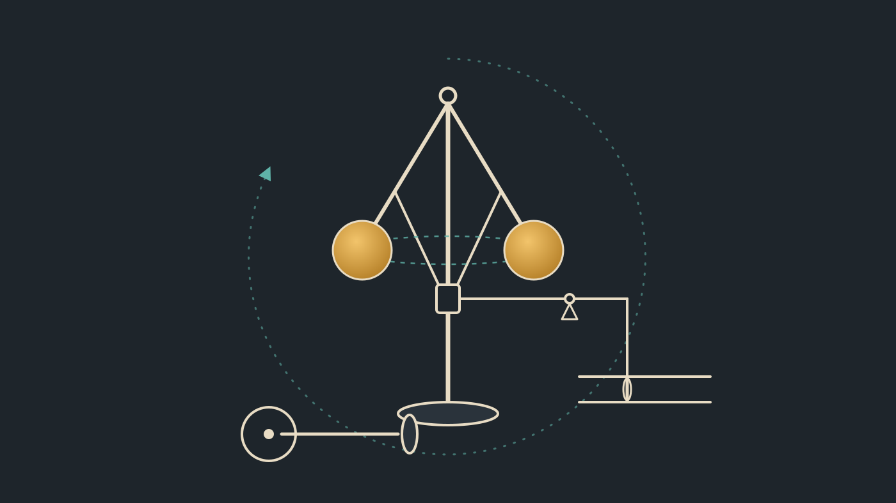

# The Governor: Letting Evidence Reshape a System

*Nobody ever finishes a system. Progressive delivery, remote-first contracts and a feedback loop that lets a system change its own shape.*

**TL;DR**

- Systems are never finished, so their shape should be able to change after design time, not only their parts.
- Progressive delivery already gates new versions on evidence. A governor can use the same evidence to decide where a module runs: folded into its caller, or split out as a service.
- A small demo shows one turn of that loop, done by hand.
- *4th bullet as a human at the keyboard ;-)*

Nobody ever finishes a system. Even a system that nobody wants to change will be forced to. A dependency publishes a vulnerability, and code that has been stable for years must be rebuilt and redeployed within days. Log4Shell made that point to most of the industry back in 2021.

Yet we still design systems as if they were finished. We pick a shape at design time, build it, and treat every later change of shape as a project. I think it is time to rethink how we do things. Here are my thoughts.

## Shape, and a worked example

At design time we usually pick a single shape, such as an application calling a service, and it stays fixed until someone replaces it: **isomorphic**. Swapping the implementation behind that service leaves the shape intact: **polymorphic**. Letting the shape itself change, a remote service folded into its caller or split back out as demand shifts, is **amorphic**.

The [Amorphic demo](what-this-demo-shows.md) attempts to show a concrete example. It starts with a Spring Boot app that calls a Python pricing service. A Java re-implementation is shadowed on live traffic, caught disagreeing on a rounding edge case, fixed, canaried and promoted, and the Python service is retired. Once the Java module has evidenced that it is correct, the app is rebuilt with it folded in and the remote service disappears. The call site and address never change. The shape does.

## Progressive delivery with evidence

At first glance this may feel fanciful, but it is grounded in established practice. LaunchDarkly describes [progressive delivery](https://launchdarkly.com/blog/progressive-delivery/) as releasing changes gradually to subsets of users and environments, in a controlled way. Typical patterns are canary launches, percentage rollouts and ring deployments. That discipline is well understood when one service replaces another.

The amorphic demo takes it one step further: the evidence that lets a new version serve traffic is also the evidence that lets the system change shape. The evidence is stricter too, because every answer is compared with the incumbent's rather than relying on error rates and latency alone.

## Service Weaver

Since sketching these ideas, I've come across Google's [Service Weaver](https://opensource.googleblog.com/2023/03/introducing-service-weaver-framework-for-writing-distributed-applications.html). It reaches a similar place from the other direction. There you write a modular monolith of components, and configuration decides whether each component runs with its caller or apart from it. The same method call stays local or becomes an RPC, with no code change. That is the fold-in and fold-out move, made a property of the framework.

The differences are where I think the interesting work is:

- **Placement.** In Service Weaver it is chosen in configuration. Here it is meant to follow evidence and demand.
- **Language.** Service Weaver's libraries are Go. Here the addresses are qualified by language.
- **Adoption.** Google moved Service Weaver into [maintenance mode](https://github.com/ServiceWeaver/weaver) in December 2024. It saw little direct use. Google's own explanation was that adopting it meant rewriting large parts of existing applications. This approach starts from the opposite assumption: you never rewrite everything, you offer one change at a time and let it earn its place.

## Presume remote

Meyer's Uniform Access Principle says a client shouldn't be able to tell how a service is implemented from the way it calls it. The demo stretches that to location: `PricingCalc.convert(...)` reads the same whether the module runs in-process or across the network. The classic objection is Waldo et al.'s [*A Note on Distributed Computing*](https://waldo.scholars.harvard.edu/publications/note-distributed-computing) (1994), which argues that papering over local and remote hides latency, memory access, concurrency and partial failure.

That critique was aimed at code designed for a single address space and then distributed. Systems are now built the other way round: most calls are designed as remote from the start, over REST, gRPC, Kafka or other transports. So here I presume remote, with timeouts, failures, and values passed rather than shared. Local then becomes the easy case of the same contract. Service Weaver lands in the same place: even its local example takes a context and returns an error.

The discipline is to keep the contract remote-shaped once a module is folded in. Sharing mutable state, leaning on the caller's transaction, or throwing instead of returning errors all work in-process, and all quietly break the fold back out. Local is allowed to be easier, but never different. That is what keeps every fold reversible.

This does not rule out local-shaped modules. They are simply known to behave differently, and their potential benefits are traded off against the flexibility of amorphic deployment. The aim is to offer options, not impose opinions.

## The governor

The governor I have in mind is the one on a steam engine. Here is a short aside for anyone who hasn't met one. As the engine speeds up, the spinning weights swing outward and close the throttle. As it slows, they drop and open it again. Nobody stands at the controls, yet the engine holds a steady speed under a changing load. I find myself returning to control theory more and more, and to feedback loops in particular.

The software governor plays the same role. In the demo, it is actually me editing a YAML file. In a real system, it knows the assets: the catalogue of versions, and the inventory of where each runs and how it is bound. It senses usage and evidence, and adjusts the shape of the system to meet demand: what to fold in, fold out, replicate or retire.

Not all changes are equal, so the governor also chooses how cautiously each one is rolled out. A patched dependency is just another version that has to earn its place, only under time pressure. The governor moves routine patches through quickly and transparently, and brings a human in when the decision is risky or ambiguous.

## The pattern travels

The demo uses a pricing function because it is easy to check, but the loop is general. Address the thing that changes, route traffic to it, gather evidence, and let a governor decide the shape. The same loop resonates across other domains:

- **AI agents.** Addresses carry the model, prompt and tool versions, and routing between them is already part of orchestration. Evals are the evidence, judged statistically rather than by exact match. A step served by a frontier model can fold into a smaller model or plain code once evidenced, and fold back out if it drifts.
- **Data pipelines.** A new transform can be shadowed against the existing output before it takes over. This is also where the pattern is hardest: writes and state have to migrate, not just traffic.
- **Infrastructure and cost.** Where work runs, on CPU or GPU, in which region, on which instance type, is another shape the governor can choose, with cost as a feedback signal rather than a monthly report.
- **Dependencies.** A patched library or a retired model version is forced change. It still has to earn its place, only under time pressure.

Each of these deserves its own treatment. The point here is that they share one loop.

## Towards an autonomic system

Evidence-gated progressive delivery, uniform addresses with swappable bindings, and a governor watching demand together let the system correct and rebalance itself. It reshapes to run efficiently as demand shifts, and brings a human into the loop when a decision is irreversible or genuinely ambiguous. The demo is the first, manual turn of that loop.

## A note on LLM assistance

These are my own ideas, realised through discussion and improvements suggested by Claude. I find it a welcome way to accelerate things.

## Sources

- [What Is Progressive Delivery All About?](https://launchdarkly.com/blog/progressive-delivery/), LaunchDarkly
- [Introducing Service Weaver: A Framework for Writing Distributed Applications](https://opensource.googleblog.com/2023/03/introducing-service-weaver-framework-for-writing-distributed-applications.html), Google Open Source Blog, March 2023
- [ServiceWeaver/weaver README](https://github.com/ServiceWeaver/weaver), including the maintenance-mode announcement
- [A Note on Distributed Computing](https://waldo.scholars.harvard.edu/publications/note-distributed-computing), Waldo, Wyant, Wollrath and Kendall, Sun Microsystems Laboratories, 1994

*If this interests you, I'd welcome your thoughts. There is only one continuum where change happens, and it has to happen safely there. After all, there's no test universe. We only get to make mistakes in this one. ;-)*
