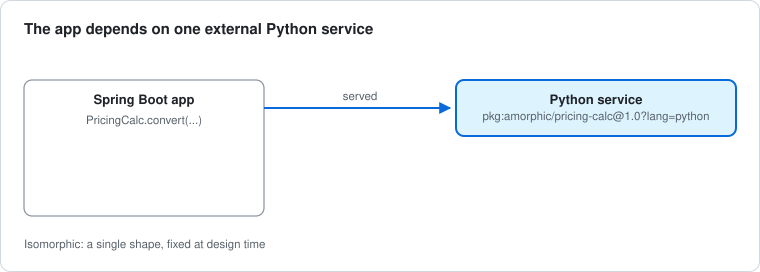
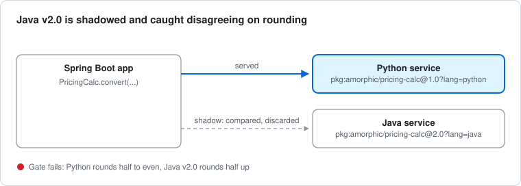
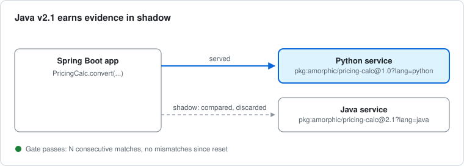
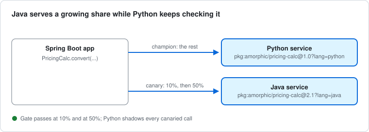
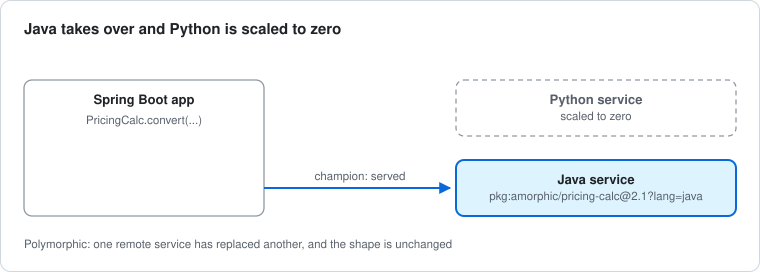
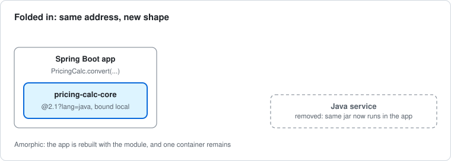
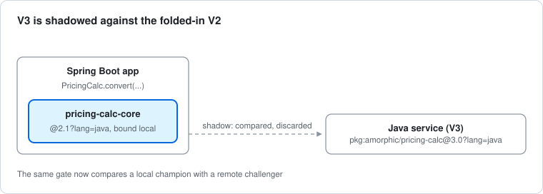
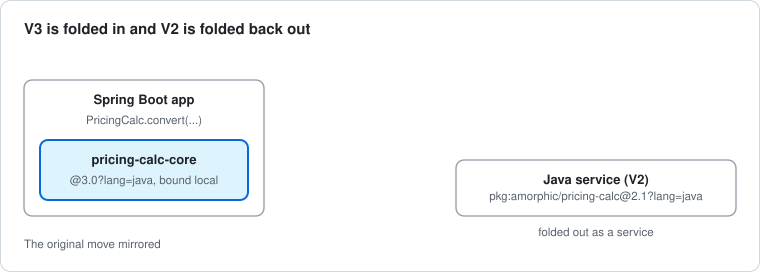
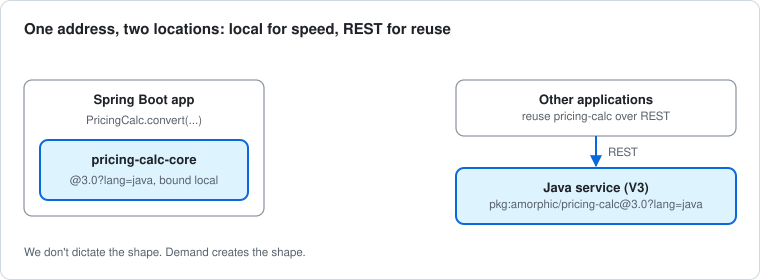

# Amorphic Demo: What This Demo Shows

At design time we usually pick a single shape: an application that calls a service. That shape stays fixed until someone decides to replace it. This is **isomorphic**.

Replacing the implementation behind that service is not a leap. A Java service takes over from a Python one, the routing changes, and the application never notices. The parts have changed, but the shape has not. This is **polymorphic**.

This demo takes one more step. Once the Java module has evidenced that it is correct, the application is rebuilt with the module folded in, and the remote service disappears. The call site is the same and the address is the same, but the shape is different. This is **amorphic**.

On the way there, the Java version is shadowed against Python on live traffic. It is caught disagreeing on a rounding edge case and is not allowed to progress until it is fixed. The shape changes only when the evidence says it can.

For the build itself, see the [plan](../amorphic-mlp-plan.md), the [story of the stages](../story.md) and the [demo walkthrough](../../amorphic-demo-env/README.md).

## Beyond the demo

The demo stops at a single fold-in, but the same moves keep going. A V3 can be deployed as a service and shadowed against the folded-in V2. When V3 proves itself, V2 is folded back out and V3 is folded in.

The shape also doesn't have to settle on a single location. If other applications later want the functionality, V3 can be offered as a REST service for them while staying folded in locally for the original app. The code then has locations, plural, co-existing under one address: one for performance, one for reuse.

We don't dictate the shape. Demand creates the shape.

## Storyboard

Each panel shows one stage: what the app calls, which address serves the answer, and what is only compared. Blue marks what serves. Dashed marks what is shadowed or gone.

### Stage 0 · Baseline

The app calls one remote address, and Python serves every answer.

### Stage 1 · Shadow (v2.0)

Callers still get Python's answer, while every call is also sent to Java and compared, and the half-penny cases expose the rounding bug.

### Stage 1b · Shadow (v2.1)

The fix is a new address, `@2.1`, so its evidence starts from zero rather than inheriting the failure recorded against `@2.0`.

### Stage 2 · Canary

The direction of serving flips for a share of calls, but every call is still compared, so trust is extended in steps.

### Stages 3 and 3b · Promote, then deprecate Python

Java becomes the champion with Python as its shadow, and then Python is stopped. Deprecation is a routing change followed by a scaling change, and the app is not redeployed. Most migrations stop here.

### Stage 4 · Fold-in

The call site and address are unchanged, but the binding is now local and the network hop has gone.

### Beyond 1 · V3 shadowed against the folded-in V2

The moves repeat with the roles reversed: the in-process V2 is now the incumbent, and V3 earns its evidence as a remote service.

### Beyond 2 · V3 folded in, V2 folded back out

The challenger joins the app and the incumbent leaves it, mirroring the original move.

Open question: once V2 is folded out, what calls it (other consumers, a fallback, a shadow for V3), or is it simply retired?

### Beyond 3 · V3 in two locations

The same address is bound locally for the original app and remotely for everyone else, so the locations co-exist rather than replace each other.

## Closing

The demo is the first, manual turn of a larger loop: evidence-gated progressive delivery, contracts that presume remote, and a governor that reshapes the system to meet demand. That argument is written up in [The Governor: Letting Evidence Reshape a System](the-governor.md).

## A note on LLM assistance

These are my own ideas, realised through discussion and improvements suggested by Claude. I find it a welcome way to accelerate things.
