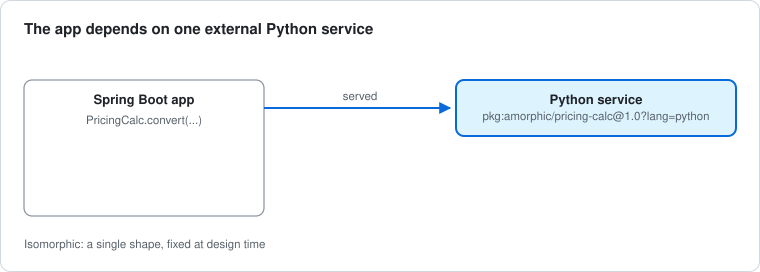
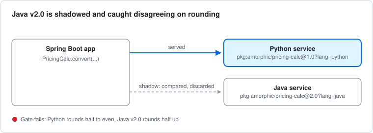
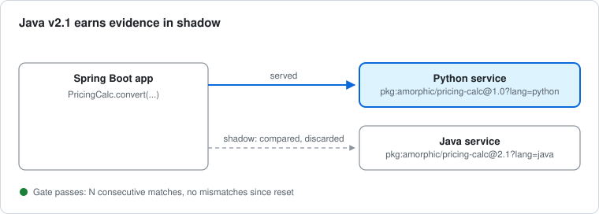
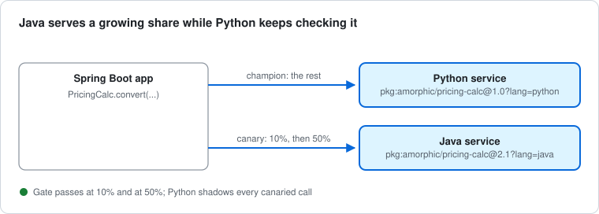
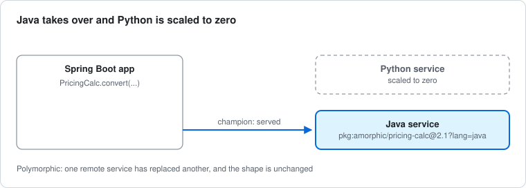
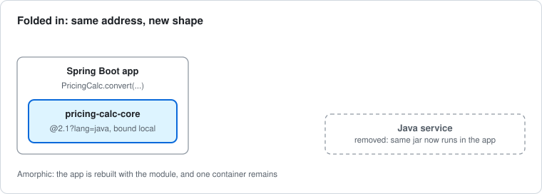

# Step-by-step guide: run the story yourself

This guide takes you through the whole demo on your own machine. A pricing capability starts as a Python service. A Java rewrite is caught with a rounding bug before any customer sees it, is fixed, earns trust in stages, and is finally folded into the app that calls it. The app's one pricing call never changes.

You'll do it twice. In **Part 1** you move the call yourself, one stage at a time, and read the evidence. In **Part 2** a rule-based governor proposes each move from that evidence, and you approve it. **Part 3** moves the tooling itself, and **Part 4** has a few experiments to try.

Allow about 45 minutes. Every output below is real, captured from a fresh clone on 2026-11-10. Request IDs, timings and exact counts change on every run, because the traffic is random.

For the why behind it, read [the story](story.md) first. For the full reference, see the [demo README](../amorphic-demo-env/README.md).

## Before you start

You need:

- **Docker** with Compose v2 (Docker Desktop is fine, including on Apple silicon).
- **git**, **curl** and **jq**.
- Free ports **8080** (the app), **8000** and **8090** (the pricing services), and **8100** and **8110** (used in Part 3).

You don't need Java or Python installed. Everything is built inside containers. You need them only to run the tests yourself (Java 21, and [uv](https://docs.astral.sh/uv/) for Python).

Clone the repository and go to the demo directory. Every command in this guide runs from there.

```bash
git clone https://github.com/StrjeP/amorphic-mlp.git
```

```bash
cd amorphic-mlp/amorphic-demo-env
```

Check that you have the two version tags. The demo builds each Java version from its tag, so you can replay the bug without changing any code:

```bash
git tag -l
```

```text
pricing-calc-java/v2.0
pricing-calc-java/v2.1
```

The first time you start a stage, Docker builds the images it needs. That takes a few minutes per image on a first run. Later runs reuse them.

## Look around first

Three things are worth seeing before you run anything.

**The one call site.** `amorphic-demo-app/src/main/java/dev/amorphic/demo/QuoteController.java` has the app's only pricing call:

```java
PricingCalc.Result result = pricingCalc.convert(id, value, from, to);
```

That line is the same in every stage. What changes is where the call goes.

**An address table.** That decision lives in a small YAML file. Here is stage 0, `addresses/stage-0.yaml`:

```yaml
capabilities:
  pricing-calc:
    champion:
      address: pkg:amorphic/pricing-calc@1.0?lang=python
      binding: { type: remote, url: http://py-pricing:8000 }
```

- The **address** names the version: pricing-calc 1.0, written in Python.
- The **binding** says how to reach it: `remote`, at a URL.
- The **role** says what it does: the `champion` serves every answer.

Each stage is a different table. `./demo diff` shows what changes between two stages:

```bash
./demo diff 0 1
```

```diff
--- stage-0.yaml
+++ stage-1.yaml
@@ -3,3 +3,6 @@
     champion:
       address: pkg:amorphic/pricing-calc@1.0?lang=python
       binding: { type: remote, url: http://py-pricing:8000 }
+    shadow:
+      address: pkg:amorphic/pricing-calc@2.0?lang=java
+      binding: { type: remote, url: http://java-pricing:8080 }
```

**The planted bug.** Java 2.0 rounds half up; the Python incumbent rounds half to even. They agree on almost everything, but not on amounts that land exactly on half a penny, when the digit before the 5 is even. For example, 10.02 GBP × 1.25 is 12.525 USD: Python says 12.52, Java 2.0 says 12.53. The fix in 2.1 is one line:

```bash
git diff pricing-calc-java/v2.0 pricing-calc-java/v2.1 -- pricing-calc-java/pricing-calc-core/src/main
```

```diff
-    static final RoundingMode ROUNDING = RoundingMode.HALF_UP;
+    static final RoundingMode ROUNDING = RoundingMode.HALF_EVEN;
```

The 2.0 build passes its own tests, because the shared test cases (the "golden vectors") don't include an even-digit half penny. That's deliberate: it's how a real port would slip through.

## Part 1: Move the call by hand

### Stage 0: Baseline



```bash
./demo stage 0
```

```bash
./demo quote 10.02
```

```json
{
  "amount": "12.52",
  "currency": "USD",
  "servedBy": "pkg:amorphic/pricing-calc@1.0?lang=python",
  "binding": "remote",
  "requestId": "1c8effa8-104b-4249-85c2-7fc25e881c8c"
}
```

Every answer says which address served it and how it was bound. Python serves everything, and that's the baseline the rest is measured against.

### Stage 1: Shadow, and the bug is caught



Java 2.0 arrives, but nobody trusts it yet. It becomes the **shadow**: every call also goes to Java in the background and the two answers are compared. Customers still only get Python's answer.

```bash
./demo stage 1
```

```text
Applied without restart: generation 2
  champion=pkg:amorphic/pricing-calc@1.0?lang=python (remote), shadow=pkg:amorphic/pricing-calc@2.0?lang=java (remote)

Stage 1 is up. Running: app py-pricing java-pricing
```

The app switched routing **without restarting**. Each applied table is a new *generation*, and evidence starts again with it.

Now send traffic: 1,200 quotes, about one in five using a half-penny amount.

```bash
./demo traffic
```

Then ask the **gate**, which passes only after 1,000 matches in a row with no mismatches:

```bash
./demo gate
```

```text
Comparisons since last reset (need >= 1000 consecutive matches, 0 mismatches):
  pkg:amorphic/pricing-calc@1.0?lang=python  vs  pkg:amorphic/pricing-calc@2.0?lang=java
    total 1200  matches 823  mismatches 377  consecutive 2
GATE FAIL
  last mismatch: 0.02 GBP->USD  served 0.02  shadow 0.03  (request traffic-1794325742-1198)
```

**This failure is the demo working.** Java 2.0 passed its build, but live comparison caught it disagreeing on 377 of 1,200 calls, and no customer saw a wrong answer. Every comparison is also an evidence log line (`./demo logs app`).

In the original run the caught case was 732.98 GBP, which is exactly 916.225 USD. That input became `RoundingRegressionTest` in version 2.1, and a new golden vector, so the lesson is now part of the build.

### Stage 1b: Fix



Version 2.1 replaces 2.0 in the shadow slot. It's a new address, so its evidence starts from zero.

```bash
./demo stage 1b
```

```bash
./demo traffic
```

```bash
./demo gate
```

```text
  pkg:amorphic/pricing-calc@1.0?lang=python  vs  pkg:amorphic/pricing-calc@2.1?lang=java
    total 1200  matches 1200  mismatches 0  consecutive 1200
GATE PASS
```

Java now gives the same answers, but it hasn't served a customer yet.

### Stage 2: Canary



Java becomes the **canary**: it serves 10% of calls. On those calls Python is still asked too, so every answer Java serves is checked.

```bash
./demo stage 2
```

```bash
./demo traffic --requests 1500
```

At 10%, only about one call in ten is compared, so use a lower bar:

```bash
./demo gate 100
```

```text
  pkg:amorphic/pricing-calc@2.1?lang=java  vs  pkg:amorphic/pricing-calc@1.0?lang=python
    total 140  matches 140  mismatches 0  consecutive 140
GATE PASS
```

Then raise it to half of all calls, with the full bar:

```bash
./demo stage 2 --weight 50
```

```bash
./demo traffic --requests 2500
```

```bash
./demo gate
```

```text
  pkg:amorphic/pricing-calc@2.1?lang=java  vs  pkg:amorphic/pricing-calc@1.0?lang=python
    total 1273  matches 1273  mismatches 0  consecutive 1273
GATE PASS
```

### Stage 3: Promote

The roles flip: Java becomes the champion, and Python becomes its shadow. The comparison keeps running, now in the other direction.

```bash
./demo stage 3
```

```diff
     champion:
-      address: pkg:amorphic/pricing-calc@1.0?lang=python
-      binding: { type: remote, url: http://py-pricing:8000 }
-    canary:
       address: pkg:amorphic/pricing-calc@2.1?lang=java
       binding: { type: remote, url: http://java-pricing:8080 }
-      weight: 50
+    shadow:
+      address: pkg:amorphic/pricing-calc@1.0?lang=python
+      binding: { type: remote, url: http://py-pricing:8000 }
```

```bash
./demo traffic
```

```bash
./demo gate
```

```text
GATE PASS
```

### Stage 3b: Deprecate



Python is switched off.

```bash
./demo stage 3b
```

```text
Stage 3b is up. Running: app java-pricing
```

```bash
./demo traffic --requests 200
```

```bash
./demo evidence
```

```json
{
  "generation": 7,
  "served": [
    {
      "address": "pkg:amorphic/pricing-calc@2.1?lang=java",
      "binding": "remote",
      "total": 200
    }
  ],
  "comparisons": []
}
```

The capability has changed language, and the app's code hasn't changed. Most migrations stop here.

### Stage 4: Fold-in



The last move changes the shape of the system. The Java logic was built as a plain library, so the app is rebuilt with it inside, and the binding becomes `local`:

```bash
./demo stage 4
```

```diff
-      binding: { type: remote, url: http://java-pricing:8080 }
+      binding: { type: local }
```

```text
Rebuilding the app with pricing-calc-core folded in (a binding change can't add code to a running app)

Stage 4 is up. Running: app
```

This is the one stage change that needs a rebuild: a running app can't load code it wasn't built with.

```bash
./demo quote 732.98
```

```json
{
  "amount": "916.22",
  "currency": "USD",
  "servedBy": "pkg:amorphic/pricing-calc@2.1?lang=java",
  "binding": "local",
  "requestId": "0a4d2325-7756-4272-8e6c-d6b049b89301"
}
```

Same call site, same address, same answer to the input that caught the bug. The separate Java service has gone; only the app is running.

## Part 2: Let the governor propose

In Part 1 you read the gate and chose each next table. Now the **governor** does the reading. It looks at what the **inventory** observes (the live table, each address's `/health`, and the evidence), applies a rule table, and proposes the next address table. **It never applies anything on its own: you approve every move.**

The rules are in `governor-rules.yaml`, tried in order. Start again from stage 1. That stage stays manual: 2.0 is withdrawn in the catalogue, so the governor would never propose it.

```bash
./demo down
```

```bash
./demo stage 1
```

```bash
./demo traffic
```

```bash
./demo propose
```

```text
Proposal g1-replace-withdrawn-shadow
  rule:      replace-withdrawn-shadow
  why:       A human withdrew the shadowed version. Shadow the newest version instead.
  this is:   stage 1b

Proposed change:
--- live (generation 1)
+++ proposal g1-replace-withdrawn-shadow
@@ -4,5 +4,5 @@
       address: pkg:amorphic/pricing-calc@1.0?lang=python
       binding: { type: remote, url: http://py-pricing:8000 }
     shadow:
-      address: pkg:amorphic/pricing-calc@2.0?lang=java
+      address: pkg:amorphic/pricing-calc@2.1?lang=java
       binding: { type: remote, url: http://java-pricing:8080 }

Nothing changes until a human approves it:  ./demo approve g1-replace-withdrawn-shadow
```

The proposal is exactly stage 1b. Approve it:

```bash
./demo approve
```

```text
Approving g1-replace-withdrawn-shadow
Applied without restart: generation 2

Now running: app py-pricing java-pricing  (stage 1b)
```

Ask again straight away, and it waits. A new table has no evidence yet:

```bash
./demo propose
```

```text
Waiting: the governor won't propose yet
  - only 0 evidence records for generation 2 (need 100)
```

From here the pattern repeats: **traffic, propose, approve.**

```bash
./demo traffic
```

```bash
./demo propose
```

```text
Proposal g2-shadow-to-canary
  rule:      shadow-to-canary
  why:       The shadow has matched the champion on enough consecutive calls. Let it serve a small share.
  evidence:  1200 consecutive matches, 0 mismatches (rule needs 1000)
  this is:   stage 2
```

```bash
./demo approve
```

Keep going. The canary steps need more traffic, because only canary calls are compared:

| Traffic | The governor proposes | Evidence in the captured run | Approve, and you're at |
|---|---|---|---|
| `./demo traffic --requests 1500` | `raise-canary` | 141 consecutive matches (needs 100) | stage 2 at 50% |
| `./demo traffic --requests 2500` | `promote` | 1267 consecutive matches (needs 1000) | stage 3 |
| `./demo traffic` | `deprecate` | 1200 consecutive matches (needs 1000) | stage 3b; Python is stopped |
| `./demo traffic --requests 200` | `fold-in` | no gate: nothing newer is catalogued, and 2.1 may run in-process | stage 4 |

Approving the fold-in asks the governor first, which says the running app can't do this live, and then rebuilds the app:

```text
Approved g6-fold-in. The governor says it needs a rebuild:
  This moves pricing-calc in-process, and the running app wasn't built with it. Rebuild the app with this table (./demo approve does this via ./demo stage 4).
...
Stage 4 is up. Running: app
```

And then there's nothing left to do:

```bash
./demo traffic --requests 200
```

```bash
./demo propose
```

```text
No proposal
  no rule applies (pricing-calc: champion pkg:amorphic/pricing-calc@2.1?lang=java local: folded in, nothing further to propose)
```

Every proposal in Part 2 was exactly the stage file you applied by hand in Part 1. The tests check that byte for byte.

## Part 3: Move the tooling

The inventory and governor have addresses in the same address table, so they can move too: in-process in the app (`local`, the default) or as their own services (`remote`). Their callers don't change. `./demo inventory` and `./demo propose` call the app as before, and the app sends each call where the table says.

Only a human moves the tooling. The governor never proposes it.

```bash
./demo stage 1b
```

```bash
./demo tooling remote
```

```diff
+  inventory:
+    champion:
+      address: pkg:amorphic/inventory@0.1?lang=java
+      binding: { type: remote, url: http://inventory:8080 }
+  governor:
+    champion:
+      address: pkg:amorphic/governor@0.1?lang=java
+      binding: { type: remote, url: http://governor:8080 }
```

```text
Starting tooling services: inventory governor

Applying the table (tooling: inventory remote, governor remote)
Applied without restart: generation 2
```

Moving the tooling is a new table, so send traffic again, then look:

```bash
./demo traffic
```

```bash
./demo inventory
```

```text
Inventory: READY  (generation 2, table from tooling: inventory remote, governor remote)

Routing and health:
  champion pkg:amorphic/pricing-calc@1.0?lang=python  remote  UP (3 ms)
  shadow   pkg:amorphic/pricing-calc@2.1?lang=java  remote  UP (3 ms)
  champion pkg:amorphic/inventory@0.1?lang=java  remote  UP (4 ms)
  champion pkg:amorphic/governor@0.1?lang=java  remote  UP (5 ms)
```

That answer came from the inventory service, and `./demo propose` now goes to the governor service:

```bash
./demo propose
```

```text
Proposal g2-shadow-to-canary
  rule:      shadow-to-canary
  ...
  this is:   stage 2
```

```bash
./demo approve
```

```text
Now running: app py-pricing java-pricing inventory governor  (stage 2)
```

The proposal left the tooling entries alone. Stage changes and approvals keep the tooling where it is. Move it back with:

```bash
./demo tooling local
```

You can also move just one: `./demo tooling remote inventory`.

## Part 4: Try it yourself

Each experiment starts with its own setup. The first three outputs come from the same captured run; the last is in the demo README.

**Stop a service and watch the inventory notice.** The inventory checks `/health` on every address, every time you ask. After Part 3 you're in stage 2, so send some traffic and then stop Java:

```bash
./demo traffic
```

```bash
docker compose stop java-pricing
```

```bash
./demo inventory
```

```text
Inventory: NOT READY  (generation 4, table from tooling: inventory local, governor local)

Routing and health:
  champion pkg:amorphic/pricing-calc@1.0?lang=python  remote  UP (1 ms)
  canary   pkg:amorphic/pricing-calc@2.1?lang=java  remote 10%  DOWN: cannot connect (nothing answered the connection)
```

```bash
./demo propose
```

```text
Waiting: the governor won't propose yet
  - pkg:amorphic/pricing-calc@2.1?lang=java (canary, http://java-pricing:8080) is not answering /health: cannot connect (nothing answered the connection)
```

The governor won't move anything while the system isn't ready. `docker compose start java-pricing` brings it back.

**Approve a proposal after the system has moved on.** Get a proposal, apply a table by hand, and then approve the old proposal:

```bash
./demo traffic --requests 1500
```

```bash
./demo propose
```

```bash
./demo apply addresses/stage-2.yaml
```

```bash
./demo approve
```

```text
Not applied: the address table has changed since this proposal (generation 4 -> 5). Ask for a new one.
```

**Change a rule while it's running.** The rules are read on every proposal. Go back to stage 1b with fresh evidence, then raise the main gate from 1,000 to 5,000 matches:

```bash
./demo stage 1b
```

```bash
./demo traffic
```

```bash
sed -i.bak 's/gate: 1000$/gate: 5000/' governor-rules.yaml
```

```bash
./demo propose
```

```text
Waiting: the governor won't propose yet
  - rule shadow-to-canary needs 5000 consecutive matches; 1200 so far
```

Put it back with `mv governor-rules.yaml.bak governor-rules.yaml` (or `git checkout governor-rules.yaml`). The catalogue is read the same way, on every look. If you delete the `withdrawn:` line from 2.0 in `catalogue.yaml` and propose from stage 1, the governor no longer replaces 2.0. It holds instead, because the versions disagree, and lists the mismatches.

**Ask for a fold-in the running app can't do.** Go to stage 3b and push the stage 4 table by hand:

```bash
./demo stage 3b
```

```bash
./demo apply addresses/stage-4.yaml
```

The app refuses it and keeps serving, because it wasn't built with the Java library inside.

## Clean up

```bash
./demo down
```

This stops every container and forgets the active stage. The built images stay, so the next run starts quickly.

## If something goes wrong

- **A port is already in use.** Stop whatever uses 8080, 8000 or 8090 (and 8100 or 8110 for Part 3), or run `./demo down` if it's an old demo run.
- **"git tag 'pricing-calc-java/v2.0' not found".** Fetch the tags: `git fetch --tags`.
- **"app did not become healthy".** Look at `./demo logs app`. On a first run, a slow image build can also cause this; run the same command again.
- **The governor keeps waiting.** It says why. Usually the table is new and needs traffic (`./demo traffic`), or a canary gate needs more compared calls (use `--requests 1500` or `2500`).
- **Anything else.** `./demo status` shows the active stage, its table and the running containers.

## Where next

- [The story](story.md): how the stages connect, in plain words.
- [The plan](amorphic-mlp-plan.md): what was built, the design decisions, and progress.
- [The demo README](../amorphic-demo-env/README.md): every command, endpoint and evidence shape, with more captured runs.
- [What this demo shows](articles/what-this-demo-shows.md) and [The Governor](articles/the-governor.md): the wider argument.
- Run the tests yourself, from the repository root: `./gradlew build` (Java 21) and `cd pricing-calc-py && uv run pytest`.
